# Evolutionary Optimization of Reinforcement Learning Policies for Autonomous Lunar Landing: A Comparative Study of Genetic Algorithms, PPO, and Hybrid GA-PPO

Course: Applied Reinforcement Learning and Optimization

Student: [Your name] | Institution: [Your institution]

Date: 09 November 2026

## Abstract

This project investigates whether evolutionary initialization improves reinforcement learning for autonomous landing in the discrete LunarLander-v3 environment. A genetic algorithm optimizes all 4,996 parameters of a neural actor, after which proximal policy optimization fine-tunes the transferred actor while learning a newly initialized critic. The comparison includes a uniformly random policy, pure genetic search, PPO from scratch, the two-stage hybrid, and a PPO-short control that matches the hybrid's gradient-training interactions. Optimization is constrained by a common interaction ceiling, with complete GA fitness episodes and complete PPO rollouts. Validation, final evaluation, and unused allocation are measured separately. Policies are selected using validation starts and then evaluated on a common, disjoint test seed set. The reported full-budget experiment uses 3 independent training seeds, an allocation of 1,000,000 transitions per main trained agent, and 100 test episodes per checkpoint. Mean test returns were -49.5 for GA, 268.4 for PPO, 244.1 for GA-PPO, and 256.2 for PPO-short. These measurements describe the implemented configuration rather than a general ranking of optimization methods. The repository supplies unit and integration tests, numerical actor-transfer verification, resumable genetic checkpoints, machine-readable interaction ledgers, learning curves, gameplay recordings, and generated report sources. Uncertainty is summarized at the training-seed level to avoid treating many episodes from one policy as independent training replications. Limitations include the small number of training seeds, validation selection effects, weight-space crossover disruption, and the cost of population evaluation. The study tests the hybrid hypothesis without assuming that combining optimization methods guarantees better performance.

## 1. Introduction

Reinforcement learning optimizes decisions whose consequences unfold over time. Autonomous landing is a useful course benchmark because attitude, velocity, contact, and engine control interact through nonlinear dynamics. An actor must trade immediate thrust costs against the delayed consequences of a stable touchdown.

Gradient optimization exploits differentiable policy models but can be sensitive to initialization and sampled trajectories. Evolution evaluates complete behaviors without differentiating through the environment, at the cost of many interactions. This project examines whether evolutionary search provides an initialization worth its cost.

Contributions are an auditable two-stage implementation, a matched architecture across methods, a PPO-short control, explicit interaction accounting, and an experiment-to-report pipeline. The null position is that GA initialization offers no consistent benefit once its interactions and wall time are included.

## 2. Literature review

Such et al. [2] study genetic optimization of deep neural policies and demonstrate that direct weight search can scale beyond small networks. Their findings motivate testing neuroevolution here, but do not establish its effectiveness for this architecture, budget, or LunarLander version.

Schulman et al. [1] introduce PPO, alternating trajectory collection with minibatch optimization of a surrogate policy objective. This project uses the tested Stable-Baselines3 implementation described by Raffin et al. [4], with explicit settings and reproducible package versions.

Khadka and Tumer [3] combine evolutionary populations and policy gradients through shared experience and periodic reinsertion of a gradient-trained policy. Our method has a single actor transfer followed by PPO training. It does not reproduce that interleaved ERL algorithm. Its narrower question concerns the value of evolved initialization.

## 3. Problem formulation and hypotheses

The task is an episodic Markov decision process M=(S,A,P,R,gamma). The eight observations encode position, linear velocity, angle, angular velocity, and two leg contacts. Actions are no thrust, left orientation engine, main engine, and right orientation engine [5]. Orientation engines apply forces and torques; they are not direct horizontal displacement commands.

The objective is expected discounted return J(theta)=E[sum_t gamma^t r_t], while evaluation reports the undiscounted episode return. Default rewards combine state-dependent shaping and engine-use penalties. Episodes end through crash, leaving bounds, resting, or the time limit. The benchmark keeps the original reward function, raw observations, discrete actions, default gravity and no wind.

H1: GA produces policies better than random under the allocated budget. H2: evolved initialization improves validation performance before PPO updates. H3: the hybrid reaches observed validation thresholds with fewer total optimization interactions than PPO. H4: the hybrid improves final return relative to both PPO and PPO-short. H5: mutation, population size, crossover, and budget fraction materially affect results. H6: any interaction advantage remains after wall-clock accounting. H7: any advantage persists under held-out disturbances. Each hypothesis can fail; evidence is reported descriptively with paired training-seed comparisons.

## 4. Methodology

All trainable actors use Linear(8,64), Tanh, Linear(64,64), Tanh, Linear(64,4). The parameter count is 8*64+64+64*64+64+64*4+4=4,996. GA selects argmax logits; PPO trains a categorical policy. The PPO critic has separate 64-unit hidden layers and a scalar output. Observations and rewards are not normalized.

Each GA chromosome concatenates weights and biases in layer order. Initialization uses independent uniform samples with the ordinary linear-layer fan-in bounds. Candidate fitness is mean return over common seeds within a generation; training seeds change between generations. Tournament selection, configurable uniform or blend crossover, per-gene Gaussian mutation, and copied elites generate the next population. Diversity is mean standard deviation across chromosome coordinates. Non-finite parameters and fitness raise errors.

GA pseudocode: initialize population; reserve a complete worst-case generation; evaluate every candidate on common episode seeds; validate the generation winner; retain the best validation checkpoint; log statistics; copy elites and breed offspring; atomically checkpoint population, counters, champion and random-generator states; repeat while another generation fits. The first actor is also a validation candidate. Selection ties retain the earlier policy. This prevents discarding a useful initial actor.

PPO optimizes Lclip=E[min(r_t*A_t, clip(r_t,1-epsilon,1+epsilon)*A_t)], where r_t is the current-to-old action-probability ratio and A_t is a generalized-advantage estimate. Clipping limits the incentive for large probability-ratio changes. The implementation also trains a value function and includes an entropy term. These are SB3 updates; no alternate PPO optimizer is substituted [1,6].

Hybrid pseudocode: allocate a fraction of the budget to GA; select its actor on validation seeds; construct a fresh PPO actor-critic; copy three actor weight matrices and bias vectors; verify raw logits and actions on synthetic and actual environment-reset observations; verify the critic is unchanged; train PPO for the remaining actual budget rounded down to complete rollouts. Optimizer state is fresh. PPO-short starts from scratch for exactly the number of transitions actually used by the hybrid's PPO stage.

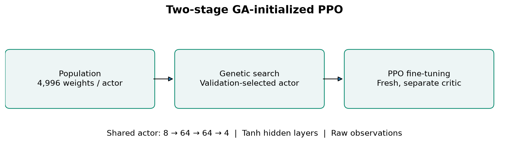

## 5. Experimental setup

Recorded mode: full. Training seeds: [11, 23, 37]. Allocation: 1,000,000 transitions per GA, PPO and hybrid run. Final evaluation: 100 episodes per saved selected model. Validation uses 5 episodes from seed 20000; final testing starts at 40000. Optimization seeds occupy separate integer domains at or above one million. Initialization, selection, crossover and mutation use separate reproducible random streams.

Primary fairness uses an equal allocation ceiling, not artificially equal actual steps. GA reserves population_size * fitness_episodes * episode_limit transitions before a generation. This conservative rule leaves some unused allocation. Hybrid PPO receives the remaining actual allocation. SB3's usual rollout rounding is explicitly handled by rounding down; the transition counter verifies the result. Selection and final-test interactions are outside the primary optimization ceiling and reported separately.

PPO validation occurs after optimizer updates at the first rollout boundary meeting the checkpoint interval and at the final update. Initial, selected, latest and final policies are distinguishable. Final evaluation uses the validation-selected model, which can be an earlier checkpoint than the last update. GA validation occurs once per generation; unequal selection opportunity is a limitation and its cost is disclosed.

Hardware: Intel64 Family 6 Model 186 Stepping 2, GenuineIntel; 12 logical CPUs; 15.7 GiB RAM. Software: Python 3.11.18, Windows-10-10.0.26200-SP0. CPU training uses 1 Torch thread(s). Package versions and resolved configuration are stored with each run. Wall time includes optimization and model selection, and excludes final testing. The delivered experiments ran on a shared workstation while report generation and exploratory sweeps also ran. These timings describe observed elapsed cost, not an isolated-system speed benchmark.

Uncertainty: compute each policy's mean across common test starts, then aggregate those means across independent training seeds. Percentile bootstrap intervals resample training-seed means (10,000 replicates). Intervals are omitted for fewer than three training seeds. With three seeds they are preliminary, not strong population evidence. Random-agent repetitions use the same fixed action RNG and are not independent training replications. Paired episode differences are descriptive; inference does not treat episodes as training seeds.

## 6. Results

Mean test returns were -49.5 for GA, 268.4 for PPO, 244.1 for GA-PPO, and 256.2 for PPO-short.

Tables report actual saved measurements. Dots in performance plots show training-seed means; error bars are seed-bootstrap intervals when available. Learning curves use validation observations and include the hybrid's GA-stage selected-champion measurements and GA cost on the primary x-axis. Separate plots show PPO-stage observations against PPO-only cost, total cost including validation, and wall time. Curves interpolate only within the range jointly observed across seeds; bands show one standard deviation, not confidence intervals.

GA fitness curves need not increase monotonically because generation seeds change. Validation-selected champion scores can increase even when current-generation scores fall. Solved-episode rate means return at least 200. A resting landing is separately identified from the simulator's sleep and crash signals; it does not guarantee the landing pad was reached. Engine action counts are a usage proxy, not fuel consumed.

The GA-minus-random mean-return difference is +128.8 points. GA's mean solved-episode rate is 1.7%. Improvement over random behavior and solving the landing task are distinct outcomes.

### Performance across training seeds

| Agent | Seeds | Return | Seed SD | 95% bootstrap CI | Solved |
| --- | --- | --- | --- | --- | --- |
| GA | 3 | -49.5 | 37.3 | [-86.4, -11.9] | 1.7% |
| GA-PPO | 3 | 244.1 | 12.3 | [230.5, 254.4] | 96.7% |
| PPO | 3 | 268.4 | 4.1 | [263.8, 271.6] | 100.0% |
| PPO-short | 3 | 256.2 | 5.2 | [250.2, 259.3] | 100.0% |
| Random | 0 | -178.3 | n/a | not estimated | 0.0% |

### Mean resource use per independent run

| Agent | Optimize | Select | Test | Unused | Seconds |
| --- | --- | --- | --- | --- | --- |
| GA | 942,568 | 77,027 | 10,428 | 57,432 | 149.3 |
| GA-PPO | 997,796 | 61,150 | 38,631 | 2,204 | 304.9 |
| PPO | 999,424 | 51,223 | 27,899 | 576 | 363.8 |
| PPO-short | 805,547 | 47,045 | 34,556 | 0 | 299.2 |
| Random | 0 | 0 | 9,148 | 0 | 0.0 |

### Paired training-seed contrasts

| Contrast | Pairs | Difference | 95% bootstrap CI |
| --- | --- | --- | --- |
| hybrid - ppo | 3 | -24.2 | [-41.1, -15.4] |
| hybrid - ppo_short | 3 | -12.0 | [-28.9, -2.7] |
| hybrid - ga | 3 | +293.6 | [242.4, 333.9] |

### Actor transfer audit (validation returns)

| Seed | Initial | After GA | Transfer | Logit error | Updated |
| --- | --- | --- | --- | --- | --- |
| 11 | -153.8 | -94.6 | -94.6 | 0.00e+00 | True |
| 23 | -663.9 | -104.5 | -104.5 | 0.00e+00 | True |
| 37 | -310.5 | -106.4 | -106.4 | 0.00e+00 | True |

### Hybrid stage trajectory (same validation starts)

| Seed | Before GA | After GA | Final PPO | Best PPO | Final gain |
| --- | --- | --- | --- | --- | --- |
| 11 | -153.8 | -94.6 | 267.3 | 267.3 | +361.9 |
| 23 | -663.9 | -104.5 | 271.1 | 271.1 | +375.6 |
| 37 | -310.5 | -106.4 | 264.5 | 264.5 | +370.9 |

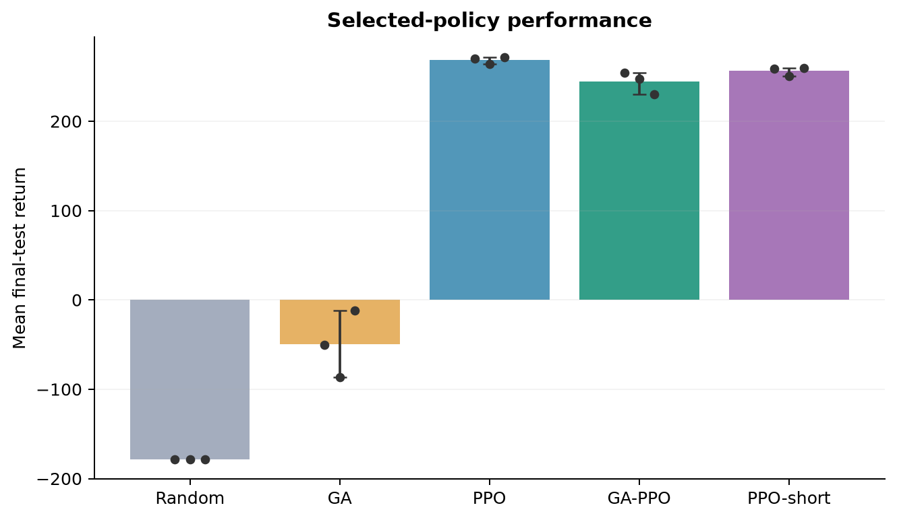

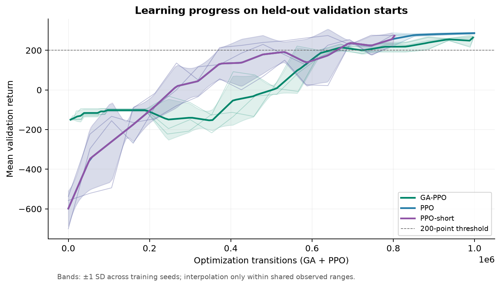

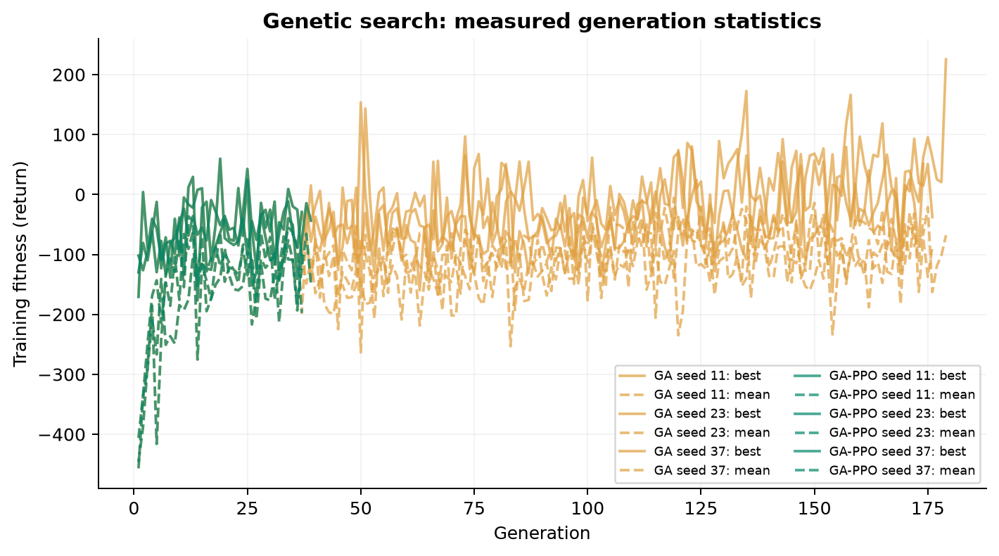

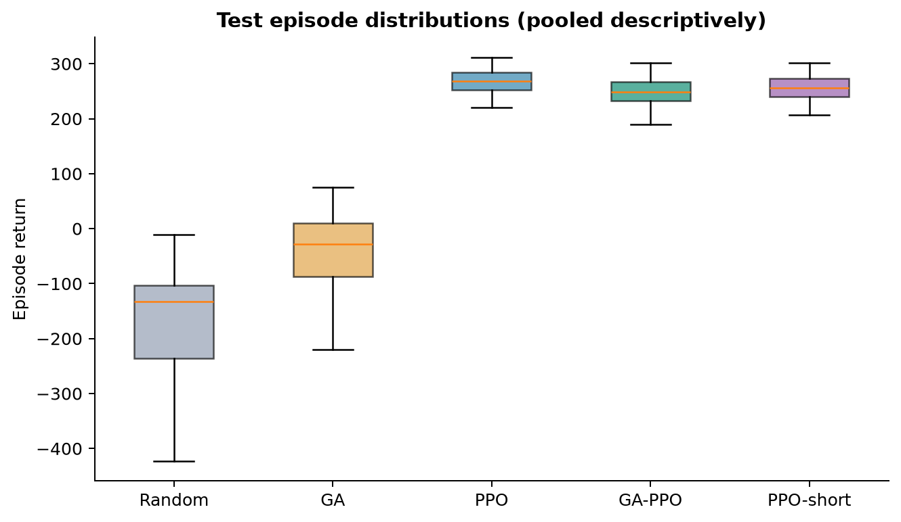

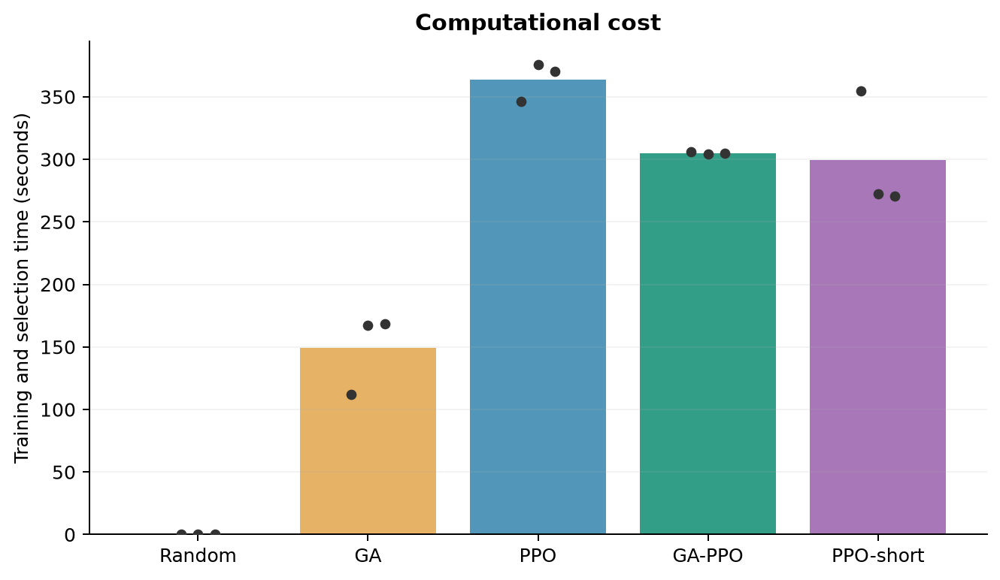

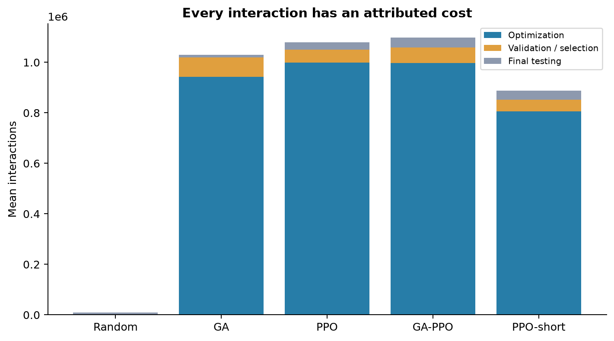

## 6.1. Sensitivity and robustness execution status

Executed sensitivity source: results/ablations/sweep_eed27f6fcc_20261109T151055Z_a7de6f. 22 measured agent runs; development seeds start at 60,000. The sensitivity budget can differ from the main study, so these results are exploratory.

The full three-seed, one-million-transition-per-agent sensitivity suite was not executed. The delivered smaller sweep tests the pipeline and provides exploratory measurements; it does not replace confirmatory ablations.

Within the tested hybrid variants for ga.crossover_probability, the highest development mean was -125.6 at 0. This is an exploratory selection across 2 settings, not an independently confirmed optimum. The baseline configuration was not changed in response to these results.

Within the tested hybrid variants for ga.mutation_sigma, the highest development mean was 21.3 at 0.02. This is an exploratory selection across 3 settings, not an independently confirmed optimum. The baseline configuration was not changed in response to these results.

Within the tested hybrid variants for ga.population_size, the highest development mean was 189.7 at 20. This is an exploratory selection across 3 settings, not an independently confirmed optimum. The baseline configuration was not changed in response to these results.

Within the tested hybrid variants for hybrid.ga_budget_fraction, the highest development mean was -102.9 at 0.4. This is an exploratory selection across 3 settings, not an independently confirmed optimum. The baseline configuration was not changed in response to these results.

Executed robustness source: results/raw/full_2f0cf7ab0f_20261109T150901Z_6d56ad/robustness/robustness_2f0cf7ab0f_20261109T153100Z_5ebc0a. Selected policies were evaluated without adaptation using identical perturbations and episode seeds across methods. This is a separate out-of-distribution evaluation.

For PPO, the lowest mean among the recorded robustness conditions was 124.9 under stronger_wind, compared with 268.4 under the default condition. These are frozen-policy evaluations, with the same test starts for every method.

For GA-PPO, the lowest mean among the recorded robustness conditions was 93.6 under stronger_wind, compared with 244.1 under the default condition. These are frozen-policy evaluations, with the same test starts for every method.

### Sensitivity results (development hold-out)

| Parameter | Value | Agent | Seeds | Budget | Gen. | Return |
| --- | --- | --- | --- | --- | --- | --- |
| Crossover prob. | 0.0 | GA | 1 | 160,000 | 200 | -68.2 |
| Crossover prob. | 0.0 | GA-PPO | 1 | 160,000 | 42 | -125.6 |
| Crossover prob. | 0.7 | GA | 1 | 160,000 | 171 | -121.2 |
| Crossover prob. | 0.7 | GA-PPO | 1 | 160,000 | 42 | -127.4 |
| Mutation SD | 0.02 | GA | 1 | 160,000 | 156 | -95.4 |
| Mutation SD | 0.02 | GA-PPO | 1 | 160,000 | 32 | 21.3 |
| Mutation SD | 0.05 | GA | 1 | 160,000 | 171 | -121.2 |
| Mutation SD | 0.05 | GA-PPO | 1 | 160,000 | 42 | -127.4 |
| Mutation SD | 0.1 | GA | 1 | 160,000 | 176 | -159.2 |
| Mutation SD | 0.1 | GA-PPO | 1 | 160,000 | 41 | -166.9 |
| Population | 10.0 | GA | 1 | 160,000 | 171 | -121.2 |
| Population | 10.0 | GA-PPO | 1 | 160,000 | 42 | -127.4 |
| Population | 20.0 | GA | 1 | 160,000 | 77 | -108.8 |
| Population | 20.0 | GA-PPO | 1 | 160,000 | 12 | 189.7 |
| Population | 30.0 | GA | 1 | 160,000 | 46 | -23.7 |
| Population | 30.0 | GA-PPO | 1 | 160,000 | 5 | -104.7 |
| GA allocation | 0.1 | GA | 1 | 160,000 | 171 | -121.2 |
| GA allocation | 0.1 | GA-PPO | 1 | 160,000 | 8 | -127.4 |
| GA allocation | 0.25 | GA | 1 | 160,000 | 171 | -121.2 |
| GA allocation | 0.25 | GA-PPO | 1 | 160,000 | 42 | -127.4 |
| GA allocation | 0.4 | GA | 1 | 160,000 | 171 | -121.2 |
| GA allocation | 0.4 | GA-PPO | 1 | 160,000 | 72 | -102.9 |

Note: `ppo_short_seed23` was not included in the robustness evaluation, so PPO-short robustness rows average seeds 11 and 37 only.

### Robustness: mean return

| Condition | Agent | Return |
| --- | --- | --- |
| default | GA | -49.5 |
| default | GA-PPO | 244.1 |
| default | PPO | 268.4 |
| default | PPO-short | 259.2 |
| default | Random | -178.3 |
| heavier_gravity | GA | -50.1 |
| heavier_gravity | GA-PPO | 236.6 |
| heavier_gravity | PPO | 254.6 |
| heavier_gravity | PPO-short | 253.5 |
| heavier_gravity | Random | -171.2 |
| lighter_gravity | GA | -40.4 |
| lighter_gravity | GA-PPO | 254.1 |
| lighter_gravity | PPO | 271.1 |
| lighter_gravity | PPO-short | 259.7 |
| lighter_gravity | Random | -188.0 |
| stronger_wind | GA | -191.2 |
| stronger_wind | GA-PPO | 93.6 |
| stronger_wind | PPO | 124.9 |
| stronger_wind | PPO-short | 110.9 |
| stronger_wind | Random | -300.9 |
| wind | GA | -136.9 |
| wind | GA-PPO | 162.7 |
| wind | PPO | 215.7 |
| wind | PPO-short | 188.6 |
| wind | Random | -245.8 |

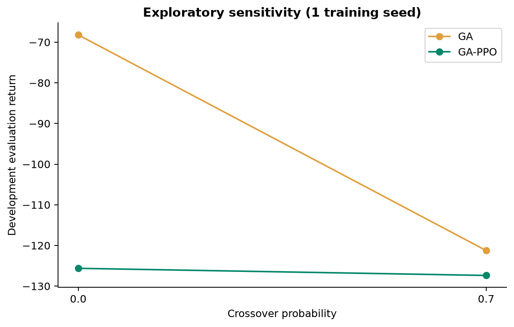

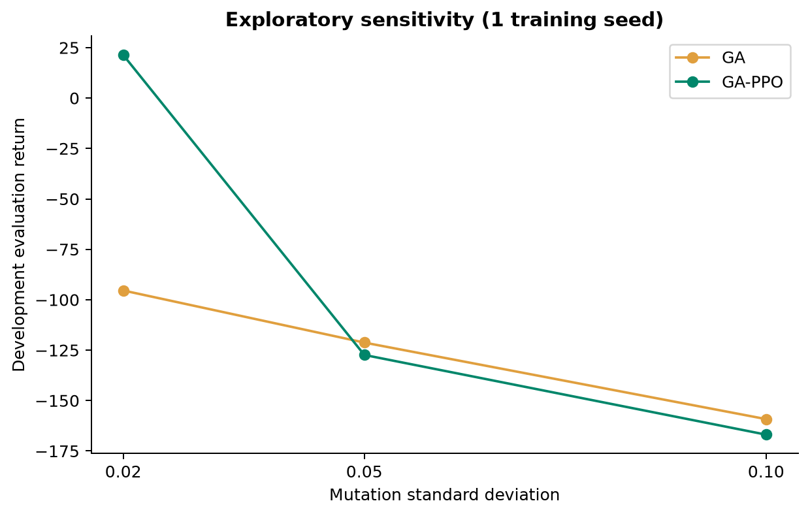

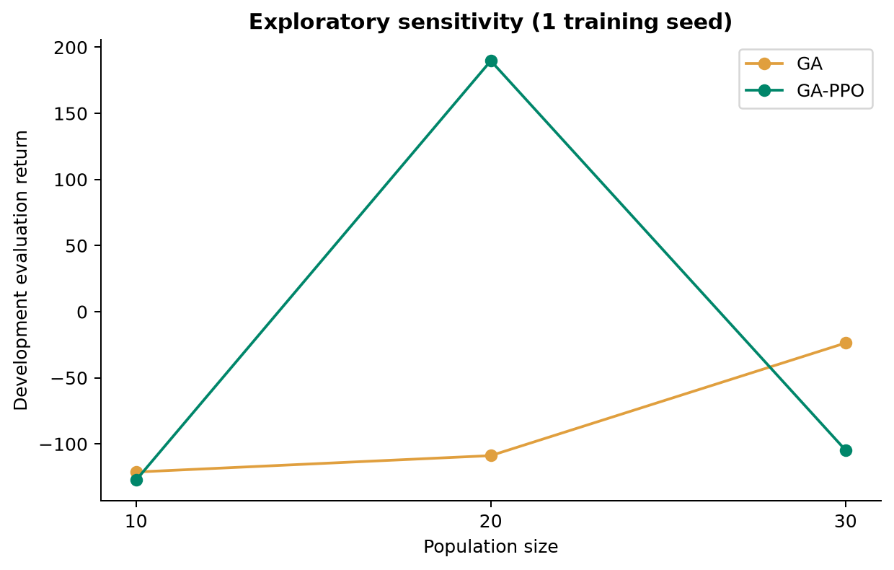

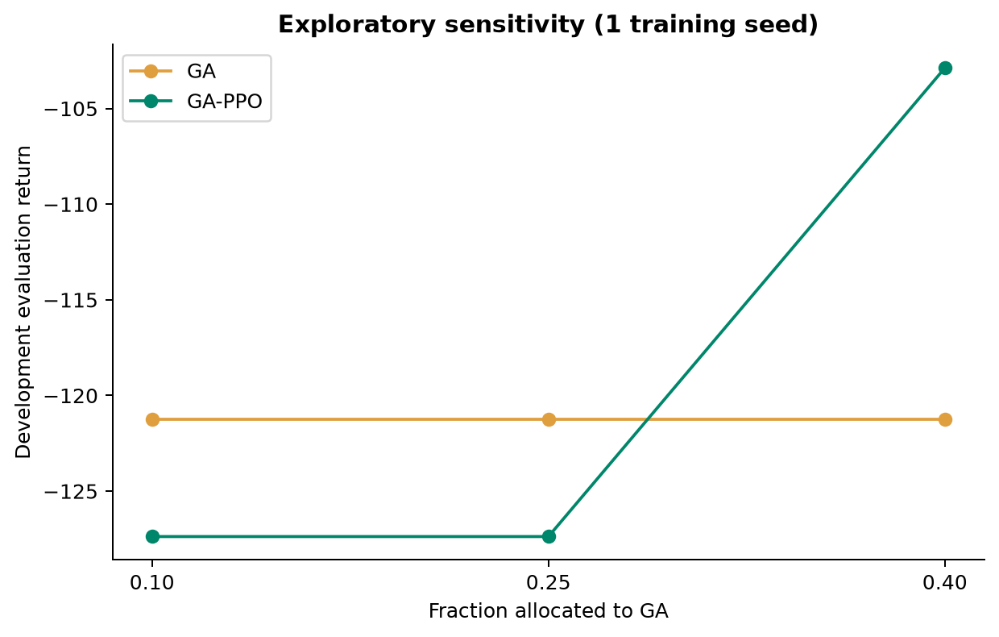

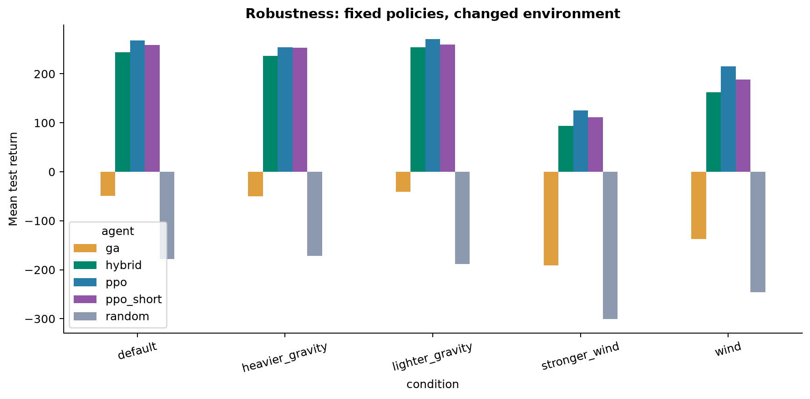

## 7. Discussion and limitations

The measured hybrid-minus-PPO difference is -24.2 return points, and the hybrid-minus-PPO-short difference is -12.0. These comparisons must be read alongside seed variation, unequal unused residuals, checkpoint selection and computational overhead. A positive point estimate alone is insufficient to establish a robust benefit; a negative estimate is evidence against the proposed advantage for this configuration.

The hybrid exceeds PPO in 0 of 3 matched training seeds. Its mean training-and-selection wall time differs from PPO by -58.9 seconds. The point estimate does not support a hybrid advantage over full-budget PPO in this experiment. Exact initialization transfer therefore should not be confused with improved sample efficiency.

The transfer test answers an engineering question: whether PPO starts from the actual evolved actor. It does not demonstrate that this actor is easy to fine-tune. Deterministic GA behavior and stochastic PPO exploration can differ sharply even when their logits match. A fresh critic may initially provide noisy advantages. Useful GA behavior may be lost during early policy-gradient updates.

The selected checkpoint can precede the final optimizer update. Reported final-test performance therefore means performance after the complete training-and-selection procedure, not necessarily the last policy. Sensitivity findings use a distinct development evaluation set; they should not be used to tune against the main test set. Repeated validation across many generations can overfit the small validation set.

The return-per-interaction ratio is provided for completeness but is not a stable efficiency ranking when returns can be negative or shifted by constants. Observed threshold crossings and learning curves are more interpretable. Thresholds that were never observed are marked not reached within budget.

## 8. Conclusion

The project implements and measures a reproducible full-budget comparison of evolutionary search, PPO and GA-initialized PPO. It establishes exact actor transfer, functioning gradient refinement, saved-model evaluation and transparent budget accounting. The recorded results above, rather than an assumed hybrid advantage, determine the comparative conclusion.

RQ1 and RQ2 are assessed through GA validation and transfer records. RQ3 and RQ4 are assessed through observed learning curves and paired final performance. RQ5 requires the sensitivity runs reported in the supplement status below. RQ6 is addressed by measured runtime and total interactions. RQ7 remains limited by the number of independent training seeds and the robustness conditions actually executed. No unexecuted experiment is treated as supporting evidence.

## 9. Future work

Extend to five or more training seeds, larger held-out validation sets, matched selection overhead, adaptive mutation, alternating evolution and PPO, population-based hyperparameter training, structured crossover, and continuous-control tasks. Consider critic warm-up and actor entropy diagnostics to explain why an evolved deterministic policy may be unstable during stochastic fine-tuning.

## Appendix: reproducibility and artifact lineage

Primary data source: results/raw/full_2f0cf7ab0f_20261109T150901Z_6d56ad. Configuration hash: 2f0cf7ab0f. The report was generated from that explicit suite; no implicit latest-run selection is used.

Install using Python 3.11 and the saved version snapshot, run scripts.doctor, then pytest. Execute scripts.run_all with the appropriate YAML. Regenerate using scripts.generate_report --run <suite>. See README.md and REPRODUCIBILITY.md for exact PowerShell commands and the execution record.

GA checkpoints store NumPy arrays plus JSON metadata, without object pickle. SB3 model files use its native serialization and should only be loaded from trusted sources. GA resumes exactly at a generation boundary under the same software. PPO models save optimizer state, but restarting the environment is not bitwise equivalent to an uninterrupted run. The suite safely archives interrupted attempts and restarts that agent.

The PDF is generated with ReportLab because no LaTeX compiler was found during implementation. The supplied main.tex and references.bib provide an alternative source build: pdflatex main; bibtex main; pdflatex main; pdflatex main. Numerical results are shared across Markdown, LaTeX and PDF outputs.

### First observed validation threshold (optimization steps)

| Agent | Seed | Threshold | Observed crossing |
| --- | --- | --- | --- |
| GA-PPO | 11 | 0 | 405,917 |
| GA-PPO | 11 | 100 | 618,909 |
| GA-PPO | 11 | 200 | 778,653 |
| GA-PPO | 23 | 0 | 566,074 |
| GA-PPO | 23 | 100 | 619,322 |
| GA-PPO | 23 | 200 | 672,570 |
| GA-PPO | 37 | 0 | 509,974 |
| GA-PPO | 37 | 100 | 563,222 |
| GA-PPO | 37 | 200 | 563,222 |
| PPO | 11 | 0 | 372,736 |
| PPO | 11 | 100 | 532,480 |
| PPO | 11 | 200 | 692,224 |
| PPO | 23 | 0 | 266,240 |
| PPO | 23 | 100 | 319,488 |
| PPO | 23 | 200 | 479,232 |
| PPO | 37 | 0 | 266,240 |
| PPO | 37 | 100 | 266,240 |
| PPO | 37 | 200 | 372,736 |
| PPO-short | 11 | 0 | 372,736 |
| PPO-short | 11 | 100 | 532,480 |
| PPO-short | 11 | 200 | 692,224 |
| PPO-short | 23 | 0 | 266,240 |
| PPO-short | 23 | 100 | 319,488 |
| PPO-short | 23 | 200 | 479,232 |
| PPO-short | 37 | 0 | 266,240 |
| PPO-short | 37 | 100 | 266,240 |
| PPO-short | 37 | 200 | 372,736 |

### Per-seed final-test means

| Agent | Seed | Return | Solved | Selected PPO step |
| --- | --- | --- | --- | --- |
| GA | 11 | -50.2 | 2.0% | n/a |
| GA | 23 | -86.4 | 1.0% | n/a |
| GA | 37 | -11.9 | 2.0% | n/a |
| GA-PPO | 11 | 254.4 | 99.0% | 806,912 |
| GA-PPO | 23 | 247.5 | 98.0% | 802,816 |
| GA-PPO | 37 | 230.5 | 93.0% | 806,912 |
| PPO | 11 | 269.8 | 100.0% | 958,464 |
| PPO | 23 | 263.8 | 100.0% | 999,424 |
| PPO | 37 | 271.6 | 100.0% | 999,424 |
| PPO-short | 11 | 259.0 | 100.0% | 798,720 |
| PPO-short | 23 | 250.2 | 100.0% | 802,816 |
| PPO-short | 37 | 259.3 | 100.0% | 806,912 |
| Random | 11 | -178.3 | 0.0% | n/a |
| Random | 23 | -178.3 | 0.0% | n/a |
| Random | 37 | -178.3 | 0.0% | n/a |

### Resolved hyperparameters

| Setting | Value |
| --- | --- |
| environment.id | LunarLander-v3 |
| environment.continuous | False |
| environment.enable_wind | False |
| environment.gravity | -10.0 |
| environment.max_episode_steps | 1000 |
| experiment.seeds | [11, 23, 37] |
| experiment.total_optimization_steps | 1000000 |
| experiment.final_eval_episodes | 100 |
| experiment.checkpoint_interval | 50000 |
| experiment.validation_episodes | 5 |
| experiment.threads | 1 |
| network.actor_hidden | [64, 64] |
| network.critic_hidden | [64, 64] |
| network.activation | tanh |
| ga.population_size | 20 |
| ga.elite_count | 2 |
| ga.tournament_size | 3 |
| ga.mutation_probability | 0.05 |
| ga.mutation_sigma | 0.05 |
| ga.crossover_probability | 0.7 |
| ga.crossover_type | uniform |
| ga.fitness_episodes | 3 |
| ga.immigrant_rate | 0.0 |
| ga.max_generations | None |
| ppo.learning_rate | 0.0003 |
| ppo.gamma | 0.999 |
| ppo.gae_lambda | 0.98 |
| ppo.clip_range | 0.2 |
| ppo.n_steps | 1024 |
| ppo.batch_size | 64 |
| ppo.n_epochs | 4 |
| ppo.ent_coef | 0.01 |
| ppo.n_envs | 4 |
| ppo.device | cpu |
| hybrid.ga_budget_fraction | 0.25 |
| hybrid.transfer_actor_only | True |
| evaluation.deterministic | True |
| evaluation.solved_reward_threshold | 200 |
| evaluation.validation_seed_start | 20000 |
| evaluation.final_seed_start | 40000 |

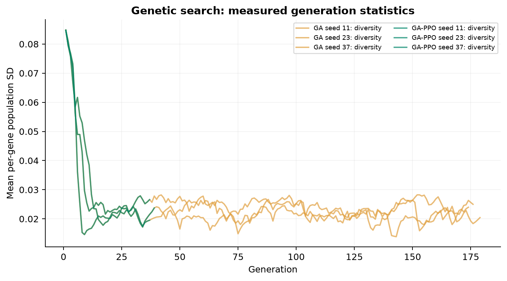

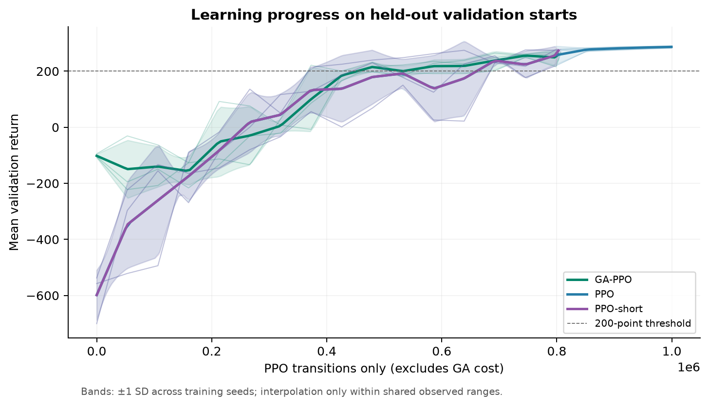

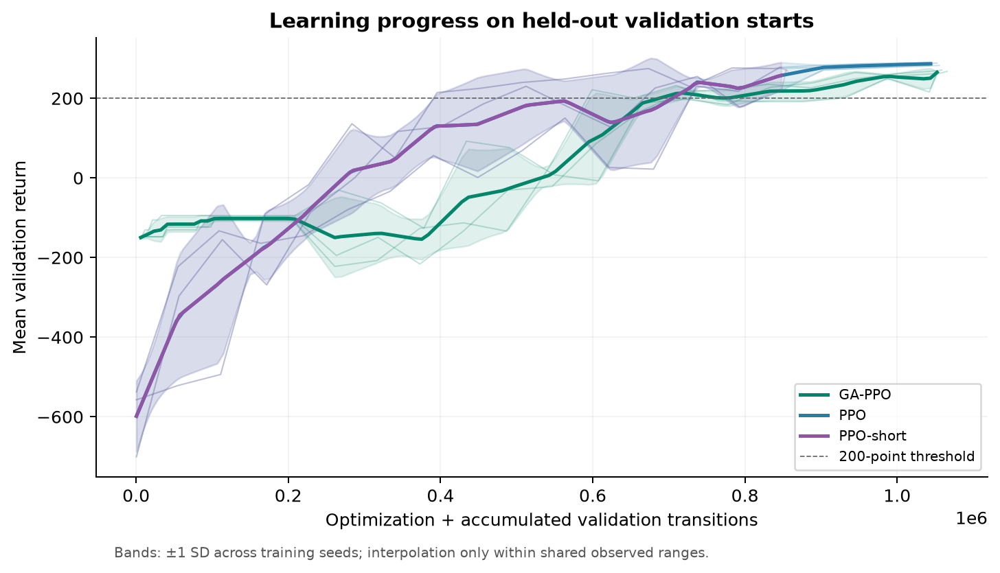

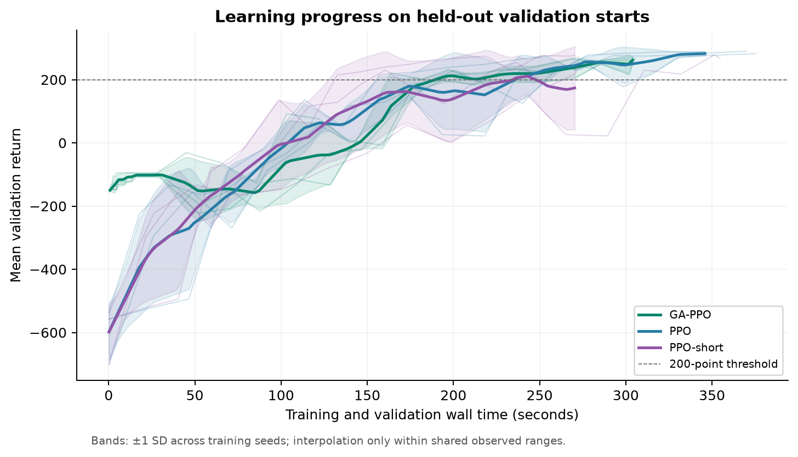

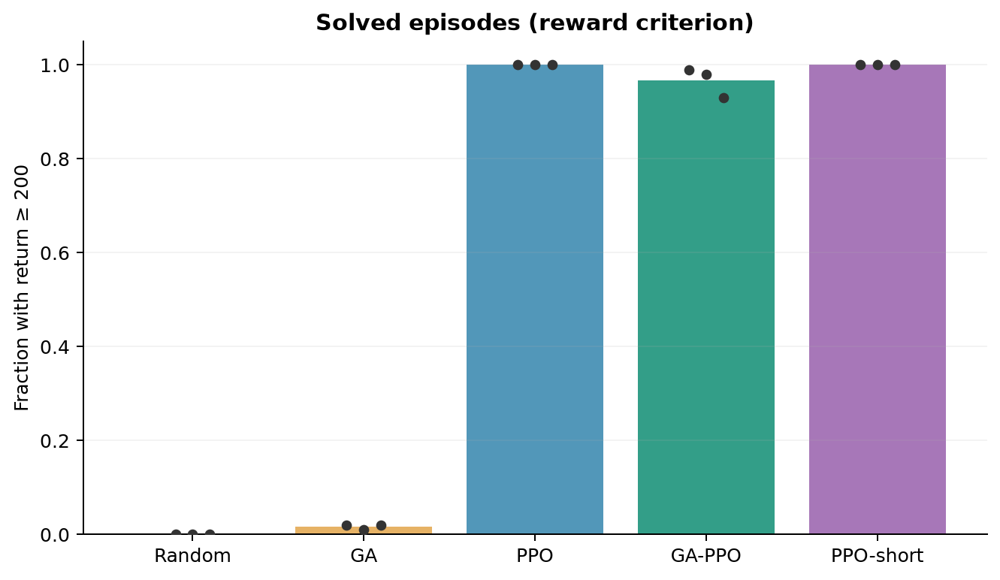

## References

1. [Schulman et al. (2017). Proximal Policy Optimization Algorithms.](https://arxiv.org/abs/1707.06347)

2. [Such et al. (2017). Deep Neuroevolution.](https://arxiv.org/abs/1712.06567)

3. [Khadka and Tumer (2018). Evolution-Guided Policy Gradient in Reinforcement Learning.](https://arxiv.org/abs/1805.07917)

4. [Raffin et al. (2021). Stable-Baselines3. JMLR 22(268), 1-8.](https://jmlr.org/papers/v22/20-1364.html)

5. [Farama Foundation. Lunar Lander documentation (accessed 9 November 2026).](https://gymnasium.farama.org/environments/box2d/lunar_lander/)

6. [Stable-Baselines3. PPO documentation (accessed 9 November 2026).](https://stable-baselines3.readthedocs.io/en/master/modules/ppo.html)